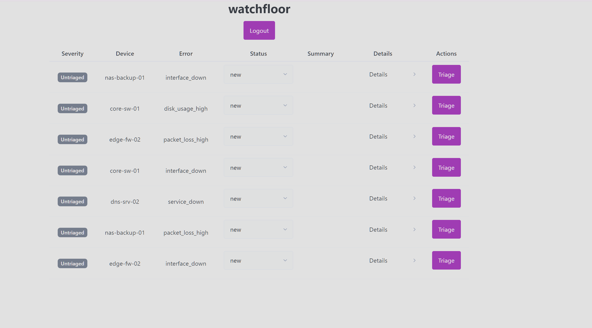
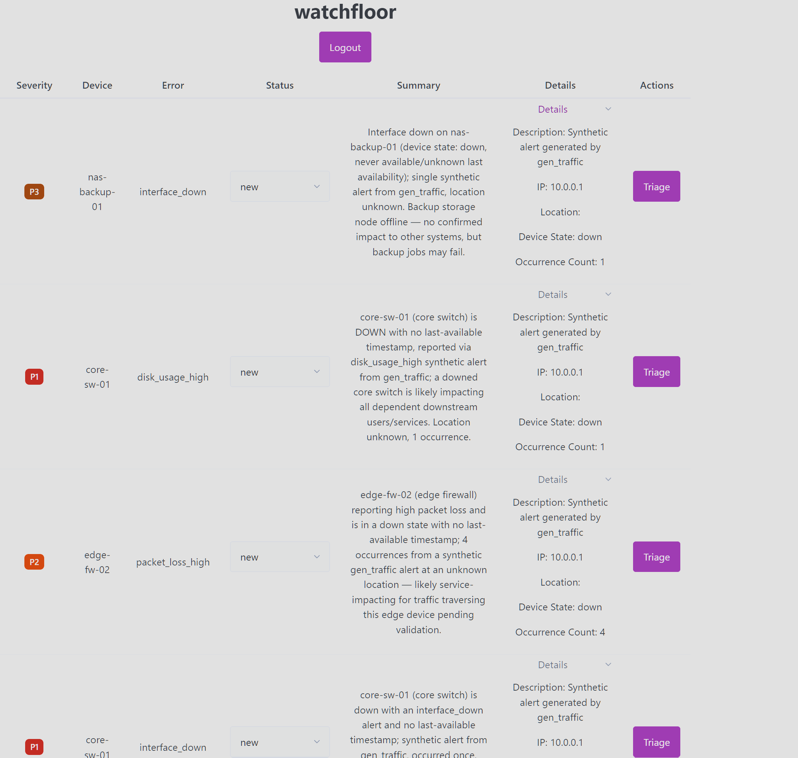
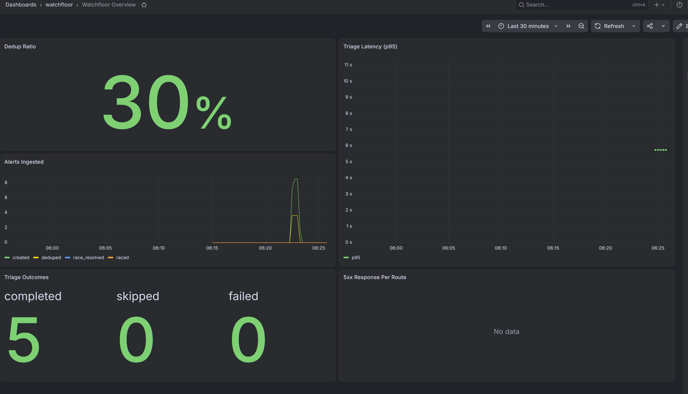
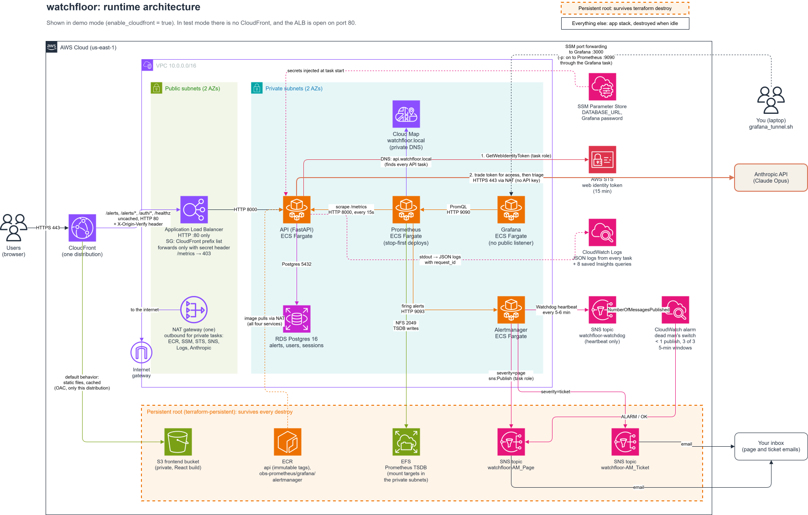
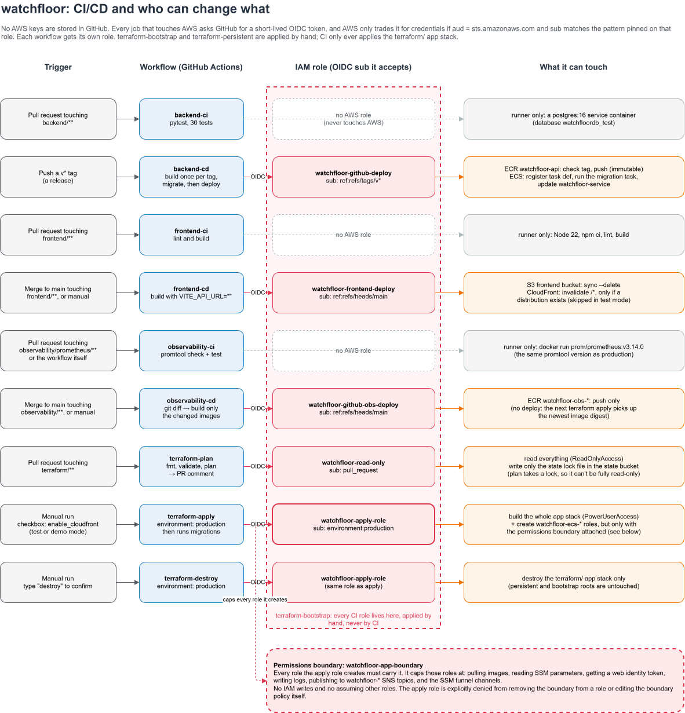

# watchfloor

An alert triage service for operations teams. It ingests infrastructure alerts, deduplicates them, and uses an LLM
(Claude Opus) to summarize each one and suggest a severity. It runs on AWS (ECS Fargate, RDS, CloudFront), its
infrastructure is defined entirely in Terraform, and it includes a self-hosted Prometheus, Grafana, and Alertmanager
stack.

[](https://github.com/saineee/watchfloor/actions/workflows/backend-ci.yml)
[](https://github.com/saineee/watchfloor/actions/workflows/frontend-ci.yml)
[](https://github.com/saineee/watchfloor/actions/workflows/observability-ci.yml)

## Why I built it

While working in an Enterprise Operations Center, I relied daily on monitoring and alerting software. That experience
inspired me to build a smaller version of my own, one that handles alert ingestion, deduplication, and AI-assisted
triage, alongside a monitoring stack for the service itself. It's a hands-on way to learn how these components fit
together and to work through the full software development lifecycle for this kind of service.

## Screenshots







## Architecture



### Request path

In demo mode, everything goes through a single CloudFront distribution. The React
frontend is served from a private S3 bucket using origin access control. Requests to
`/alerts`, `/alerts/*`, `/auth/*`, and `/healthz` skip the cache and go to an
Application Load Balancer, which forwards them to the FastAPI service running on ECS
Fargate in private subnets.

The API stores alerts, users, and sessions in RDS Postgres, and calls the Anthropic
API to triage alerts. Since the frontend and API are served from the same origin, I
don't need any CORS configuration.

### Test and demo modes

The apply workflow has an `enable_cloudfront` checkbox that switches between two setups:

| Mode           | CloudFront | ALB                                                           | Used for                                 |
|----------------|------------|---------------------------------------------------------------|------------------------------------------|
| Test (default) | Off        | Open on port 80                                               | Quick applies, failure testing, runbooks |
| Demo           | On         | Only reachable through CloudFront (see [Security](#security)) | Running the full app over HTTPS          |

### Terraform layout

The infrastructure is split into three Terraform roots, grouped by how much damage a
bad apply could do:

| Root                   | What's in it                                                                                | When it's applied                    |
|------------------------|---------------------------------------------------------------------------------------------|--------------------------------------|
| `terraform-bootstrap`  | State bucket, GitHub OIDC roles, permissions boundary                                       | Manually, and rarely                 |
| `terraform-persistent` | ECR repositories, Prometheus EFS volume, frontend bucket, SNS topics, Logs Insights queries | Manually                             |
| `terraform`            | Everything else: VPC, ALB, ECS, RDS, CloudFront, Cloud Map, observability services          | By CI, and destroyed when not in use |

The main stack is built from nine modules: `vpc`, `security`, `alb`, `ecs`, `rds`,
`cloudfront`, `cloudmap`, `efs`, and `observability`. I keep it torn down most of the
time because the NAT gateway alone costs about $32 a month. I bring it up when I'm
working on it and destroy it afterward. Container images, metrics history, and the
built frontend all live in the persistent root, so they survive every destroy.

### Backend

The API is built with FastAPI (async, Python 3.12), SQLAlchemy 2 with psycopg 3, and
Alembic for migrations. Passwords are hashed with argon2. Sessions are stored
server-side in a `sessions` table, and the browser only holds an opaque token in an
httpOnly, Secure, SameSite=Lax cookie.

The test suite has 30 tests, and CI runs them against a real Postgres service
container instead of SQLite.

### Triage

`POST /alerts/{id}/triage` sends the alert's fields to Claude using structured
outputs, so the response is validated against a Pydantic schema with a `severity`
(P1 to P5) and a `summary`.

Before calling the model, the API hashes the alert's triage fields with SHA-256. The
prompt also includes `occurrence_count`, but that's left out of the hash on purpose
(see [Key decisions](#key-decisions)). If the hash matches the last triage, the API
skips the call, so I don't pay to triage an unchanged alert twice.

Errors are grouped by whether retrying might help. Rate limits and connection errors
return a 503, and responses the API can't use return a 502. If triage fails, the
alert is left as it was.

### Deduplication

An incoming alert counts as a duplicate if an open alert already exists with the same
`device_name` and `error_type`. This is enforced by a partial unique index with
`WHERE status <> 'resolved'`. Instead of creating a new row, a duplicate increments
`occurrence_count` on the existing alert. Because the database enforces this, two
alerts arriving at the same time can't both get inserted, which a check-then-insert
approach wouldn't guarantee.

## Pipelines



Every part of the system is checked on pull requests and deployed on merge or on a
tag. None of the workflows use long-lived AWS keys. Each one assumes its own IAM role
through GitHub OIDC.

| Part           | CI (on pull request)                      | CD                                                |
|----------------|-------------------------------------------|---------------------------------------------------|
| Backend        | `backend-ci`: pytest against Postgres 16  | `backend-cd`, on a `v*` tag                       |
| Frontend       | `frontend-ci`: lint and build             | `frontend-cd`, on merge                           |
| Observability  | `observability-ci`: promtool rule checks  | `observability-cd`, on merge                      |
| Infrastructure | `terraform-plan`: fmt, validate, and plan | `terraform-apply` and `terraform-destroy`, manual |

Some details on how each one works:

- **Backend:** The image is built once per tag. Tags are immutable, so re-running the
  workflow deploys the existing image instead of rebuilding it. Migrations run as a
  one-off ECS task before the service is rolled.
- **Frontend:** The build is synced to S3 with `--delete`. CloudFront is only
  invalidated if a distribution exists, since there isn't one in test mode.
- **Observability:** CI runs `promtool check rules` and `promtool test rules` using
  the same pinned Prometheus image that's deployed. On merge, CD uses a git diff to
  build only the images whose folders changed.
- **Infrastructure:** The plan is posted as a comment on the PR. Apply is triggered
  manually, runs in the `production` GitHub environment, and runs migrations
  afterward. Destroy is also manual and requires typing a confirmation.

## Security

### No long-lived credentials

GitHub Actions authenticates to AWS through OIDC. Plan, apply, backend deploy,
observability deploy, and frontend deploy each have their own role, and each role is
restricted to a specific subject claim: pull requests, the `production` environment,
`v*` tags, or `main`.

The deployed API doesn't have an Anthropic API key either. It uses workload identity
federation: the ECS task gets a short-lived web identity token from AWS and uses that
to authenticate with the Anthropic API.

### Permissions boundary

The apply role can only create IAM roles that have the `watchfloor-app-boundary`
permissions boundary attached, and it's explicitly denied from editing or removing
that boundary. The boundary itself blocks IAM writes and assuming other roles. The CI
roles are defined in the bootstrap root, which CI never applies, so the pipeline
can't change its own permissions.

### Restricting the ALB to CloudFront

In demo mode, the ALB only accepts traffic from CloudFront, enforced in two places.
The security group only allows CloudFront's managed origin-facing prefix list, and a
listener rule only forwards requests that include a secret `X-Origin-Verify` header,
which is generated during the same apply. Anything else gets a fixed 403.

`/metrics` returns a 403 at the ALB in both modes. Prometheus scrapes the tasks
directly instead.

### Private frontend bucket

All public access to the frontend bucket is blocked. The bucket policy uses an
`AWS:SourceArn` condition so only this CloudFront distribution can read from it.

### Grafana access

Grafana isn't exposed publicly. I reach it through SSM port forwarding using
`scripts/grafana_tunnel.sh`.

### Authentication

Login returns the same 401 whether the email doesn't exist or the password is wrong.
When the email is unknown, the API still runs a dummy hash check so both cases take
about the same time, which prevents anyone from using response times to find valid
emails. Logging out deletes the session on the server, so a copied cookie stops
working right away.

## Observability

### Metrics

The API exposes Prometheus metrics for:

- Alerts ingested, broken down by result: created, deduplicated, or lost a race to a
  concurrent insert
- Triage outcomes and latency
- HTTP requests by route and status code

Prometheus discovers API tasks through Cloud Map DNS service discovery, so new tasks
get scraped automatically without changing any config. Its TSDB is stored on an EFS
volume in the persistent root, so metrics history is kept even when I tear down the
whole stack.

### Dashboards

Grafana is provisioned from code with a "Watchfloor Overview" dashboard that shows
the dedup ratio, alerts ingested, p95 triage latency, triage outcomes, and 5xx
responses per route.

### SLO

The target is for 90% of triage requests to succeed over a rolling 30-day window.
Skipped triages, where the alert hadn't changed, aren't counted. That gives a 10%
error budget, and the two burn rate alerts are based on it. `TriageSlowBurn` fires
at a 1x burn rate, meaning the budget would run out right at the end of the 30 days.
`TriageFastBurn` fires at 5x.

### Alerts

Alertmanager sends `page` and `ticket` alerts to SNS email topics. It authenticates
with its ECS task role, so there are no access keys involved.

| Alert            | Fires when                                                                   | Severity |
|------------------|------------------------------------------------------------------------------|----------|
| `TriageFastBurn` | More than 50% of triage requests fail over 5 minutes, for at least 2 minutes | page     |
| `TriageSlowBurn` | More than 10% fail over 30 minutes, for at least 10 minutes                  | ticket   |
| `APIDown`        | The API scrape target is down or missing (`absent()`) for 2 minutes          | page     |
| `Watchdog`       | Always firing, as a heartbeat (see below)                                    | n/a      |

### Dead man's switch

If the alerting pipeline itself breaks, it can't send an alert about it. To catch
that, the `Watchdog` alert is always firing, and Alertmanager sends it to its own SNS
topic every 5 to 6 minutes. A CloudWatch alarm watches that topic and pages me if
three 5-minute periods go by without a message.

### Logs

The API writes structured JSON logs, and each request gets a `request_id` that's
carried through the async code. There's also an access log that records latency. I
saved eight CloudWatch Logs Insights queries in the persistent root, including
latency by route, errors over time, errors by alert, and tracing a single request.

## Runbooks

Every alert has a `runbook_url` annotation, so the link shows up at the top of the
page email. All of the runbooks follow the same structure: what the signal means,
what feeds it, likely causes, checks with the exact commands to run, how to mitigate,
and how to confirm it's resolved.

- [APIDown](docs/runbooks/apidown.md)
- [TriageFastBurn](docs/runbooks/triage-fast-burn.md)
- [TriageSlowBurn](docs/runbooks/triage-slow-burn.md)
- [Watchdog](docs/runbooks/watchdog.md)

## Failure testing

I ran four experiments. For each one, I wrote down what I expected to happen, broke
something on purpose, and compared the result to my prediction.

### 1. Scale Alertmanager to 0

**Expected:** The dead man's switch pages within 15 to 20 minutes.

**What happened:** It took 26 minutes. The heartbeat was only being sent every 10
minutes, and CloudWatch didn't treat the gaps between those sparse data points as
missing, so the alarm took longer to trip.

**Fix:** I set `group_interval: 1m` in Alertmanager and used `FILL(m1, 0)` metric math
in the CloudWatch alarm so empty periods count as zero. On a rerun, it paged at 16
minutes.

### 2. Stop the API task

**Expected:** ECS starts a replacement and traffic recovers.

**What happened:** The replacement was up 76 seconds later, but the old target kept
draining for the default 300 seconds.

**Fix:** I lowered the target group's deregistration delay to 30 seconds.

### 3. Stop the Prometheus task

**Expected:** ECS starts a replacement.

**What happened:** This uncovered a problem from an earlier deploy that I hadn't
noticed. A rolling deploy had started the new Prometheus task before stopping the old
one, and the new task couldn't get the TSDB lock on EFS. It crash-looped for about an
hour, roughly 60 tasks failed, and nothing alerted.

**Fix:** Prometheus now uses stop-first deploys, and every service has the ECS
deployment circuit breaker enabled with rollback. I reran it as a real deployment: the
old task stopped 52 seconds before the new one started, and no tasks failed.

### 4. Deploy a Grafana revision with a broken health check

**Expected:** ECS notices the problem.

**What happened:** The new task kept failing and restarting forever while the old
task kept serving traffic, and nothing alerted.

**Fix:** The deployment circuit breaker added after experiment 3 covers this case
too. On a rerun, ECS rolled back on its own after 3 failed tasks, about 9 minutes in,
and Grafana stayed up the whole time.

## Key decisions

### Running migrations in the pipeline instead of on container start

If migrations run when the container starts, multiple tasks can race each other to
run them, and a bad migration crash-loops the whole service. I learned this the hard
way: one deploy passed every health check while failing every real request with
`relation "users" does not exist`. Now migrations run as a separate pipeline step,
and the deploy only continues if they succeed.

### Giving every mutable field a single owner

If Terraform and a pipeline both try to manage the same thing, they end up
overwriting each other. So the API's task definition is owned by the release
pipeline, and Terraform is set to ignore it. The observability images go the other
way: Terraform picks up the latest image digest with `most_recent`, so that pipeline
only builds and pushes images and never deploys them.

### Self-hosting Prometheus and Grafana

I chose to run Prometheus and Grafana myself instead of using the managed AWS
versions, because I wanted to learn how they actually work and how to operate them.
CloudWatch still handles the AWS side, like logs and the dead man's switch, while
Prometheus handles the application metrics.

### Testing against real Postgres

The dedup index relies on a partial `WHERE` clause, and the schema uses native enums.
SQLite would silently ignore both, so tests passing there wouldn't prove much. As a
safety check, the test suite refuses to run unless the database name ends in `_test`.

### Deciding when to re-triage based on input, not time

The API only re-triages an alert if the hash of its triage fields changes, not
because time has passed. `occurrence_count` is included in the prompt so the model
has that context, but it's left out of the hash. That way, a noisy device that keeps
firing the same alert doesn't trigger a paid re-triage that wouldn't change the
result.

### Routing API paths in CloudFront instead of using an `/api` prefix

CloudFront uses four ordered path behaviors to send API requests to the ALB. I didn't
add an SPA fallback, because CloudFront's custom error pages apply to the entire
distribution. That would turn the API's real 403 and 404 responses into
`index.html`, which would make API errors very confusing to debug.

### Keeping the session cookie `Secure` in every mode

This means logging in doesn't work in test mode, since that mode uses plain HTTP to
the ALB. I decided that was worth it, because turning `Secure` off would mean sending
session cookies unencrypted through a public load balancer.

## How to run it

### Locally

Docker Compose runs Postgres, the API, Prometheus, Grafana, and Alertmanager:

```bash
docker compose up --build
```

The API needs a `backend/.env` file with at least `SECRET_KEY`, plus either
`ANTHROPIC_API_KEY` or the workload identity settings. The frontend runs separately:

```bash
cd frontend && npm ci && npm run dev
```

To generate test traffic, use `scripts/gen_traffic.sh`. It needs a
`scripts/.env.traffic` file with login credentials, and `--help` lists the options.

### On AWS

1. Apply `terraform-bootstrap` and then `terraform-persistent` by hand.
2. Run the **Terraform Apply** workflow. Check `enable_cloudfront` if you want demo
   mode. This workflow also runs the database migrations.
3. Push a `v*` tag to release the API. The frontend deploys automatically when
   changes are merged to `main`.
4. When you're done, run the **Terraform Destroy** workflow and type `destroy` to
   confirm.

To reach Grafana, run `scripts/grafana_tunnel.sh`. For the Prometheus UI, run
`scripts/grafana_tunnel.sh -p`.

## Known limitations

### Cost-driven infrastructure choices

There's one NAT gateway, RDS runs in a single availability zone, and backups are off.
These keep costs down for a demo that's torn down most of the time. A production
setup would want a NAT gateway per AZ, Multi-AZ RDS, and backups enabled.

### TLS ends at CloudFront

The ALB only listens on HTTP. Traffic between CloudFront and the ALB isn't encrypted,
though the ALB is still restricted to CloudFront as described in
[Security](#restricting-the-alb-to-cloudfront).

### No logged-in traffic in test mode

Because the session cookie is always `Secure` and test mode uses plain HTTP, you
can't stay logged in there. Use localhost or demo mode instead.

### Prometheus downtime on deploys

Prometheus is down for about a minute on every deploy. That's the tradeoff for
stop-first deploys, which are needed because only one Prometheus instance can write
to the TSDB on EFS at a time.

### New API routes need a CloudFront behavior

Any new top-level API route needs a matching CloudFront path behavior. Otherwise,
requests to it go to S3 instead of the API.

### Expired sessions aren't cleaned up on a schedule

Expired session rows are only deleted when someone tries to use them. Nothing
removes them on a schedule.

### Hardcoded identifiers

A few config files have account IDs and other identifiers hardcoded, such as the
Alertmanager SNS topic ARNs and the workload identity settings. None of them are
secrets, but templating them would make it easier for someone else to deploy the
project.

## License

[MIT](LICENSE)
