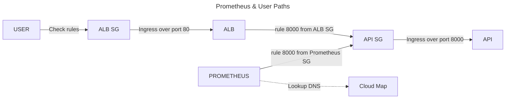

# APIDown Runbook

## Summary

Prometheus cannot reach the API's `/metrics` endpoint or there is no scrape target at all. Severity: page

## Which mode am I on?

```bash
CF="$(aws cloudfront list-distributions --query "DistributionList.Items[0].DomainName" --output text)"
```

```bash
ALB="$(aws elbv2 describe-load-balancers --names "watchfloor-alb" --query "LoadBalancers[0].DNSName" --output text)"
```

```bash
if [ "$CF" = "None" ] || [ -z "$CF" ]; then TARGET="http://$ALB"; echo "test mode"; else TARGET="https://$CF"; echo "demo mode"; fi
```

| Result    | Mode          | $TARGET                |
|-----------|---------------|------------------------|
| test mode | ALB is open   | http://<alb>           |
| demo mode | ALB is locked | https://<distribution> |

## Description

This alert is triggered when the `up` metric has been at a value of 0 for 2 or more continuous minutes or `absent()`
has been at a value of 1 for 2 or more continuous minutes.

`up`: Prometheus' record of whether the last scrape succeeded

`absent()`: Populates when every task's `up` metric has disappeared. There is no instance IP because absent is a
job-level result, not a metric for every task.

## Impact

This alert could mean that the entire app stack is still technically up, but refusing scrapes from Prometheus.
Monitoring will cease to work due to this including all SLO data. If the API backend is down, users will receive errors
from the ALB(502/503).

## Diagram



## Rule

**Any `terraform apply` in this runbook: Make sure you read the plan first and if it includes unrelated changes, stop
and escalate immediately**

## Fixes

Every action that says "restore", "roll back", or "deploy" refers to [Mitigation](#mitigation) at the bottom.

## Disclaimer

Every command in this runbook assumes the viewer will run them in the same shell session.

## First Checks

Make sure you refer to [Which mode am I on?](#which-mode-am-i-on) before running these commands.

If on demo mode run these commands:

```bash
CF_ID=$(aws cloudfront list-distributions --query "DistributionList.Items[0].Id" --output text)
```

```bash
aws cloudfront get-distribution-config --id "$CF_ID" --query "DistributionConfig.Origins.Items[0].CustomHeaders.Items[?HeaderName=='X-Origin-Verify'].HeaderValue" --output text
```

```bash
LISTENER=$(aws elbv2 describe-listeners --load-balancer-arn "$(aws elbv2 describe-load-balancers --names watchfloor-alb --query 'LoadBalancers[0].LoadBalancerArn' --output text)" --query "Listeners[0].ListenerArn" --output text)
```

```bash
aws elbv2 describe-rules --listener-arn "$LISTENER" --query "Rules[].Conditions[?Field=='http-header'].HttpHeaderConfig.Values[]" --output text
```

| Result | Meaning                                                                                                                           | Action                                                         |
|--------|-----------------------------------------------------------------------------------------------------------------------------------|----------------------------------------------------------------|
| 403    | CloudFront reached the ALB, but the `X-Origin-Verify` value does not match the listener rule, so it 403'ed due to fixed-response. | Compare the two secrets, then restore drift via **Mitigation** |

```bash
curl -s -o /dev/null -w "%{http_code}\n" --max-time 10 "$TARGET/healthz"
```

| Result | Meaning                                                                                                               | Go to                           |
|--------|-----------------------------------------------------------------------------------------------------------------------|---------------------------------|
| 200    | ALB received a regular response from the API. Prometheus is not able to reach the API.                                | **Scrape Path**                 |
| 502    | ALB was able to send the request to the target, but the<br/>target's response was bad or connection was refused.<br/> | **ECS**                         |
| 503    | ALB does not have any healthy targets to send request to.                                                             | **ECS**                         |
| 504    | ALB sent the request but timed out trying to receive a response from the API.                                         | **Networking Check 6 then ECS** |
| 000    | Curl was not able to receive a response from the ALB.                                                                 | **Networking**                  | 

## Scrape Path

| Hop               | Details                                                                                                             |
|-------------------|---------------------------------------------------------------------------------------------------------------------|
| 1. Config         | Check if the target is still `api.watchfloor.local:8000` located at `observability/prometheus/prometheus.yml`.      | 
| 2. Cloud Map      | Check if CloudMap still has an instance for the API server. If there is, does the ip match the running task in ECS? |
| 3. Security Group | On the API's security group: is there an 8000 inbound from Prometheus's security group?                             |
| 4. /metrics       | Does the `/metrics` endpoint still exist? Is there an auth layer on it now?                                         |

### Hop Checks

1. **Config**: Navigate to the repo and go to `observability/prometheus/prometheus.yml`. Check that the `names` key
   contains a list item with `"api.watchfloor.local"`.
   The `type` key must be `"A"` because the Cloud Map DNS record is type A. The `port` key must be `8000` as that is
   what the API container listens on. Caveat: This repo may not
   hold accurate information, for the reason that someone may have merged a configuration change, but has not run
   `terraform apply` because the automated Obs Workflow only pushes
   the new image to the repo. To diagnose, run `terraform plan` in the `/terraform` directory. See if there is a pending
   change on the Prometheus Task Definition, which would
   mean that the running config is behind `main`. To possibly remediate, review `terraform plan`, and apply only if
   every change is expected.
   If there are no findings here, move to hop 2.


2. **Cloud Map**: Run each command in sequential order.

```bash
NAMESPACE=$(aws servicediscovery list-namespaces --query "Namespaces[?Name=='watchfloor.local'].Id" --output text)
 ```  

```bash
echo "$NAMESPACE"
```

If you get nothing back, the namespace does not exist, along with all the other services on it. Hence, no reason to run
the other commands.

```bash
SVC_ID=$(aws servicediscovery list-services --filters "Name=NAMESPACE_ID,Values=$NAMESPACE" --query "Services[?Name=='api'].Id" --output text)
```   

```bash
CLOUDMAP_IP="$(aws servicediscovery list-instances --service-id "$SVC_ID" --query "Instances[].Attributes.AWS_INSTANCE_IPV4" --output text)"
```  

```bash
TASK_ARN=$(aws ecs list-tasks --cluster watchfloor-cluster --service-name watchfloor-service --query "taskArns[0]" --output text)
```

```bash
echo "$TASK_ARN"
```

**If this prints `None`, APIDown's absent() case: no task is running. Go to ECS**

```bash
TASK_IP="$(aws ecs describe-tasks --cluster watchfloor-cluster --tasks "$TASK_ARN" --query "tasks[0].attachments[0].details[?name=='privateIPv4Address'].value" --output text)"
```

```bash
echo "$TASK_IP - $CLOUDMAP_IP"
```

| Output               | Meaning                                                                                         |
|----------------------|-------------------------------------------------------------------------------------------------|
| Matching             | Cloud Map is correct, move to hop 3                                                             |
| Different briefly    | Cloud Map may have an outdated cache, but should replace it with the new task within 30 seconds |
| Different persistent | Cloud Map is pointing to a dead task                                                            |
| Cloud Map IP empty   | No instance is registered, therefore Prometheus has no scrape target. Go to **ECS**             |

3. **Security Group**

| Security Group | Name                       | Relevant rule                                | 
|----------------|----------------------------|----------------------------------------------|
| API tasks      | `watchfloor-ecs-task-sg`   | Inbound 8000 from `watchfloor-prometheus-sg` |
| Prometheus     | `watchfloor-prometheus-sg` | Outbound on all IPs                          |

Run each command in sequential order.

```bash
API_SG="$(aws ec2 describe-security-groups --filters "Name=group-name,Values=watchfloor-ecs-task-sg" --query "SecurityGroups[].GroupId" --output text)"
```

```bash
PROM_SG="$(aws ec2 describe-security-groups --filters "Name=group-name,Values=watchfloor-prometheus-sg" --query "SecurityGroups[].GroupId" --output text)"
```

```bash
aws ec2 describe-security-group-rules --filters "Name=group-id,Values=$API_SG" --query "SecurityGroupRules[?IsEgress==\`false\` && ReferencedGroupInfo.GroupId=='$PROM_SG'].{FromPort: FromPort, ToPort: ToPort}" --output text
```

```bash
aws ec2 describe-security-group-rules --filters "Name=group-id,Values=$PROM_SG" --query "SecurityGroupRules[?IsEgress==\`true\` && CidrIpv4 && IpProtocol].{IpProtocol: IpProtocol, CidrIpv4: CidrIpv4}" --output text
```

| Type    | Output       | Meaning                                        | Action                                                                                                         |
|---------|--------------|------------------------------------------------|----------------------------------------------------------------------------------------------------------------|
| Ingress | 8000 8000    | The correct rules are in place for ingress     | Check Egress below                                                                                             |
| Ingress | Nothing      | The security group ingress rule does not exist | Run `terraform plan` and review, and only apply if every change is expected.                                   |
| Ingress | Other ports  | The ingress rules are incorrect                | Refer to the **Important** section below.                                                                      |
| Egress  | 0.0.0.0/0 -1 | The correct rules are in place for egress      | If both Egress on `watchfloor-prometheus-sg` and Ingress on `watchfloor-ecs-task-sg` are correct, go to hop 4  |
| Egress  | Nothing      | The security group egress rule is missing      | Refer to the **Important** section below. Note: Expect a deadman's switch alert due to the missing egress rule |

**Important**: If after running `terraform plan` in the `/terraform` directory you see that there is a change to the
security group, that is drift. Review the plan, and only apply if every change is expected. If there
are no changes after running `terraform plan`, then someone has most likely merged the wrong port on the security group.
Make sure that the `watchfloor-ecs-task-sg` is referencing `watchfloor-prometheus-sg` inbound on port 8000.
`watchfloor-prometheus-sg`
conversely should be outbound on all ports. `cidr_ipv4` should be equal to `"0.0.0.0/0"`, and ip_protocol should be
equal to `"-1"`. Prometheus needs outbound access to the API over port 8000, Alertmanager over 9093, and EFS over 2049.
The groups themselves cannot be missing here. A missing Prometheus group OR egress rule would page the deadman's switch
instead, and AWS will not allow you to delete a group attached to a running task.

4. **/metrics**

Navigate to `/scripts` and type `./grafana_tunnel.sh` from the directory. Username is admin and the password is copied
to your clipboard. Navigate to Grafana Explore.
Run these queries:

1) `up{job="watchfloor-api"}`
2) `scrape_duration_seconds{job="watchfloor-api"}`
3) `scrape_samples_scraped{job="watchfloor-api"}`

| up | scrape_duration_seconds    | scrape_samples_scraped | Possible meaning                                                                  |
|----|----------------------------|------------------------|-----------------------------------------------------------------------------------|
| 1  | Normal (1 second or lower) | Hundreds               | Healthy: `/metrics` is fine, so the problem is somewhere else                     |
| 0  | About 10 seconds           | 0                      | The endpoint is too slow, or the path is blocked **Refer to hop 3**               |
| 0  | Fast                       | 0                      | Answered but the response is possibly malformed. Rollback **Refer to mitigation** |

For the exact error, use the targets page, then escalate.

**Prometheus Script**: Navigate to the repo and go to `/scripts`. In that folder you will find
`grafana_tunnel.sh`. Run the script from the directory using `./grafana_tunnel.sh -p` to forward to the Prometheus UI
for the targets page. Open the link it prints `/targets`, and check the scrape target state (`UP`/`DOWN`), along with the last error.

## Causes

1. Prometheus config changed but not applied: Hop 1
2. Cloud Map service replaced by a Terraform change: Hop 2
3. Security group rule removed or changed: Hop 3
4. `/metrics` broken by any type of code change: Hop 4
5. API task crashing or unhealthy status: ECS
6. ALB is unreachable: Networking

## ECS

### Check 1

```bash
aws ecs describe-services --cluster watchfloor-cluster --services watchfloor-service --query "services[].{A_Running:runningCount, B_Desired:desiredCount}" --output text
```

| Result | Meaning                                                                                                  | Action                                                                                                                                                                                                                                                                                           |
|--------|----------------------------------------------------------------------------------------------------------|--------------------------------------------------------------------------------------------------------------------------------------------------------------------------------------------------------------------------------------------------------------------------------------------------|
| 1/1    | ECS is fine, but ALB declares task as unhealthy                                                          | `TG="$(aws elbv2 describe-target-groups --query "TargetGroups[?TargetGroupName=='watchfloor-alb-tg'].TargetGroupArn" --output text)"`<br>`aws elbv2 describe-target-health --target-group-arn "$TG" --query "TargetHealthDescriptions[].TargetHealth.{State:State,Reason:Reason}" --output text` |
| 0/1    | Exec role can't pull image/App crashing/Ran out of IPs                                                   | Go To **Check 2 & Check 3**                                                                                                                                                                                                                                                                      |
| 0/0    | ECS desired count was set to 0, either via a Terraform change or the AWS CLI. absent() metric will fire. | `terraform plan` and review, only apply if every change is expected - **Who did it**: `aws cloudtrail lookup-events --lookup-attributes AttributeKey=EventName,AttributeValue=UpdateService --max-results 5`                                                                                     |

| Target Health | Meaning                                                            |
|---------------|--------------------------------------------------------------------|
| healthy       | ALB is sending traffic                                             |
| unhealthy     | failing /healthz endpoint. See `Reason`, then checks 3 and 4.      |
| initial       | still being checked, wait about a minute                           |
| draining      | actively draining connections and is on its way out after a deploy |

### Check 2 ###

```bash
aws ecs describe-services --cluster watchfloor-cluster --services watchfloor-service --query "services[].events[:5].[createdAt,message]" --output table
```

| Result                                              | Meaning                                             | Action                                          |
|-----------------------------------------------------|-----------------------------------------------------|-------------------------------------------------|
| has reached a steady state/deployment completed     | Healthy: the deployment finished                    | Not an ECS problem, go back to **First checks** |
| was unable to place a task                          | ECS could not start the task. see the Reason        | Match the reason to **Check 3**                 |
| has started 1 tasks repeating, with no steady state | Task started, then died. Crash or health check loop | **Check 3** for the stopped reason              |
| registered 1 targets in (target-group)              | New task joined the ALB                             | No action, normal during recovery               | 

### Check 3

```bash
TASKS=$(aws ecs list-tasks --cluster watchfloor-cluster --service-name watchfloor-service --desired-status STOPPED --query 'taskArns[0]' --output text)
```

```bash
echo "$TASKS"
```

**If this prints `None`, there is no stopped task. Either nothing has failed recently or it expired from ECS's
stopped-task history. See below**

```bash
aws ecs describe-tasks --cluster watchfloor-cluster --tasks "$TASKS" --query 'tasks[0].{Status:lastStatus,Code:stopCode,Reason:stoppedReason,ExitCode:containers[0].exitCode}' --output text
```

**IMPORTANT**   
ECS only holds stopped tasks for about 1 hour, so if it's gone, the evidence has expired. Fall back to the service
events and logs.

| Result                      | Meaning                                             | Action                                                                                                                                                                                      |
|-----------------------------|-----------------------------------------------------|---------------------------------------------------------------------------------------------------------------------------------------------------------------------------------------------|
| CannotPullContainerError    | Network Error/Exec role issue/Image reference issue | see **Image pull failure** below                                                                                                                                                            |
| Essential container exited  | Exit code 1: App crashed, Exit code: 137, killed    | see **Check 4** for logs                                                                                                                                                                    |
| ResourceInitializationError | Could not fetch a secret from SSM                   | see `/terraform/modules/ecs/main.tf` - `resource.aws_iam_role_policy.exec_role_ssm_policy`, make sure `ssm:GetParameters on Resources = [var.database_url_ssm_arn]`                         |

**Image pull failure**

```bash
IMAGE=$(aws ecs describe-task-definition --task-definition watchfloor-api --query "taskDefinition.containerDefinitions[0].image" --output text)
```

**If the image contains an '@', use the digest commands below, otherwise use the tag commands.**

**TAG**

```bash
TAG="${IMAGE##*:}"
```

```bash
aws ecr describe-images --repository-name watchfloor-api --image-ids imageTag="$TAG"
```

**DIGEST**

```bash
DIGEST="${IMAGE##*@}"
```

```bash
aws ecr describe-images --repository-name watchfloor-api --image-ids imageDigest="$DIGEST"
```

| Result                                        | Meaning                                         | Action                                                                                                                                        | 
|-----------------------------------------------|-------------------------------------------------|-----------------------------------------------------------------------------------------------------------------------------------------------|
| ImageNotFoundException                        | Image does not exist                            | deploy a tag that exists by re-running a backend-cd workflow (newest one)                                                                     |
| Image exists, error mentions "access denied"  | Execution role does not have the correct policy | Check execution role policy for `ecr:BatchGetImage`, `ecr:GetDownloadUrlForLayer`, `ecr:GetAuthorizationToken`, and restore through Terraform |
| Image exists, but timeout or connection issue | Task is not able to reach ECR over the network  | Check private subnets route through NAT gateway via `terraform plan`                                                                          |

### Check 4 ###

```bash
aws logs tail /ecs/watchfloor --since 30m --filter-pattern '{ $.level="ERROR" }'
```

## Networking

Note: curling the ALB on demo mode will return 000 due to timing out, this is intentional.

If on Demo Mode, run these commands:

```bash
CF_ID=$(aws cloudfront list-distributions --query "DistributionList.Items[0].Id" --output text)
```

```bash
aws cloudfront get-distribution --id "$CF_ID" --query "Distribution.{Status:Status,Enabled:DistributionConfig.Enabled}" --output table
```

| Status/Enabled      | Meaning                               | Action                                      |
|---------------------|---------------------------------------|---------------------------------------------|
| `Deployed`/`True`   | Healthy and serving traffic           | Continue with networking checks             |
| `InProgress`/`True` | Still rolling out (couple of minutes) | Wait and re-check                           |
| Any/`False`         | The distribution is disabled          | `terraform plan`, then apply under the rule |
| An error/`None`     | You're on test mode                   | Re-run **Which mode am I on?**              |

### Check 1

```bash
ALB="$(aws elbv2 describe-load-balancers --names "watchfloor-alb" --query "LoadBalancers[0].DNSName" --output text)"
```

```bash
echo "$ALB"
```

If this shows `LoadBalancerNotFound`, the ALB is down, deleted, or the stack is down. Restore it in accordance with the
`terraform apply rule` at the top of this runbook.
If it prints the ALB's DNS name, move to check 2.

### Check 2

```bash
curl -s -o /dev/null -w "%{http_code}\n" --max-time 10 "http://httpforever.com"
```

If this times out and prints `000`, your network is most likely the issue. However, if you receive `200` as a response,
move to check 3.

### Check 3

```bash
dig +short "$ALB"
```

If nothing is printed, the name did not resolve. So the ALB is either gone, or your DNS resolver is failing. If the DNS
works, move to check 4.

### Check 4

```bash
aws elbv2 describe-load-balancers --names "watchfloor-alb" --query "LoadBalancers[0].State.Code" --output text
```

| `State.Code`      | Meaning                                  | Action                                           |
|-------------------|------------------------------------------|--------------------------------------------------|
| `active`          | Ready                                    | **Check 5**                                      |
| `provisioning`    | Still being created, e.g. after an apply | Wait a few mins then re-run                      |
| `active_impaired` | Running but degraded on AWS's side       | Check AWS Health; likely escalate to AWS Support |
| `failed`          | AWS couldn't set up the ALB              | `terraform plan` then escalate                   |

### Check 5

Run:

```bash
aws ec2 describe-security-groups --filters "Name=group-name,Values=watchfloor-alb-sg" --query 'SecurityGroups[0].IpPermissions[?FromPort==`80`].{Cidr:IpRanges[0].CidrIp,PrefixList:PrefixListIds[0].PrefixListId}' --output table
```

Demo Mode: CloudFront's prefix list ID, which should match the `PrefixList` above.

```bash
aws ec2 describe-managed-prefix-lists --filters "Name=prefix-list-name,Values=com.amazonaws.global.cloudfront.origin-facing" --query "PrefixLists[0].PrefixListId" --output text
```

| Mode | Expected                                                 |
|------|----------------------------------------------------------|
| Test | `Cidr` = `0.0.0.0/0`, `PrefixList` = `None`              |
| Demo | `Cidr` = `None`, `PrefixList` = The CloudFront list's ID |

If this does not return the expected response in the table above according to the mode you're on, run `terraform plan`,
and act in accordance with the `terraform apply` rule at the
top of this runbook. If all 5 checks pass, try another network or a hotspot, then `terraform plan` for the ALB listener,
routes and NACLs, then escalate.

### Check 6 (504 Error)

```bash
ALB_SG="$(aws ec2 describe-security-groups --filters "Name=group-name,Values=watchfloor-alb-sg" --query "SecurityGroups[].GroupId" --output text)"
```

```bash
API_SG="$(aws ec2 describe-security-groups --filters "Name=group-name,Values=watchfloor-ecs-task-sg" --query "SecurityGroups[].GroupId" --output text)"
```

```bash
aws ec2 describe-security-group-rules --filters "Name=group-id,Values=$API_SG" --query "SecurityGroupRules[?IsEgress==\`false\` && ReferencedGroupInfo.GroupId=='$ALB_SG'].{FromPort: FromPort, ToPort: ToPort}" --output text
```

If this returns `8000 8000`, the ALB-API route is fine. Move to **ECS**. If nothing returns, the rule from the ALB is
gone, so the ALB will return 504. `terraform plan` will show it as drift, restore it in accordance with the
`terraform apply` rule.

## Mitigation

| Fix                                      | When                                                                                  | How                                                                                                                                                                                                                                                                                                                               |
|------------------------------------------|---------------------------------------------------------------------------------------|-----------------------------------------------------------------------------------------------------------------------------------------------------------------------------------------------------------------------------------------------------------------------------------------------------------------------------------|
| Restore drift                            | Someone changed AWS via CLI or Console, not Terraform                                 | run `terraform plan` in the affected root. Make sure that all changes are expected, if so `terraform apply` and confirm.                                                                                                                                                                                                          |
| Roll back the release                    | An app code change broke something                                                    | run `aws ecs list-task-definitions --family-prefix watchfloor-api --sort DESC --query "taskDefinitionArns[1:4]"`, start from the newest number then `aws ecs update-service --cluster watchfloor-cluster --service watchfloor-service --task-definition watchfloor-api:<N>` caveat: **check 1** shows the running task definition |
| Deploy an image that exists              | The image is missing                                                                  | run the backend-cd workflow (`v0.1.6` or later, never an older tag)                                                                                                                                                                                                                                                               |
| Fix the Terraform code in a pull request | `terraform plan` shows no changes, but the config is incorrect                        | Open a feature branch with `git switch -c <branch>`, stage changes, commit, then push. Create a pull request with `gh pr create --fill`, and then rebase+merge on GitHub. After merging, run the apply workflow (or apply by CLI for bootstrap and persistent).                                                                   |
| Wait and re-check                        | Temporary: `provisioning`, `initial`, a deploy that's in progress, a Cloud Map hiccup | Wait 3-5 minutes then re-run the check that sent you here                                                                                                                                                                                                                                                                         |
| Escalate (AWS Support, AWS Health)       | Every check passes, or `active_impaired`/`failed`                                     | If the runbook has exhausted all options, escalate to the service owner. If evidence points to AWS, check AWS Health at `health.aws.amazon.com`, then the AWS re:Post community forums, and on a paid plan, open a technical support case.                                                                                        |                                                                                                                                     

## Verify Resolved

### Check 1

```bash
curl -s -o /dev/null -w "%{http_code}\n" --max-time 10 "$TARGET/healthz"
```

Confirm response `200`

### Check 2

```bash
aws ecs describe-services --cluster watchfloor-cluster --services watchfloor-service --query "services[].{A_Running:runningCount, B_Desired:desiredCount}" --output text
```

Confirm `1 1`

### Check 3

```bash
NAMESPACE=$(aws servicediscovery list-namespaces --query "Namespaces[?Name=='watchfloor.local'].Id" --output text)
```  

```bash
SVC_ID=$(aws servicediscovery list-services --filters "Name=NAMESPACE_ID,Values=$NAMESPACE" --query "Services[?Name=='api'].Id" --output text)
```   

```bash
CLOUDMAP_IP="$(aws servicediscovery list-instances --service-id "$SVC_ID" --query "Instances[].Attributes.AWS_INSTANCE_IPV4" --output text)"
```  

```bash
TASK_ARN=$(aws ecs list-tasks --cluster watchfloor-cluster --service-name watchfloor-service --query "taskArns[0]" --output text)
```

```bash
TASK_IP="$(aws ecs describe-tasks --cluster watchfloor-cluster --tasks "$TASK_ARN" --query "tasks[0].attachments[0].details[?name=='privateIPv4Address'].value" --output text)"
```

```bash
echo "$TASK_IP - $CLOUDMAP_IP"
```

Confirm that the Task IP and the CloudMap IP Match.

### Check 4

Run `./grafana_tunnel.sh` from the `/scripts` directory. Log into Grafana and query `up{job="watchfloor-api"}` in
Grafana Explore. The script will copy the Grafana password to your clipboard with username 'admin'. Success is up
returns 1.

### Check 5

Confirm a resolution of the alert arrived in your email inbox.
