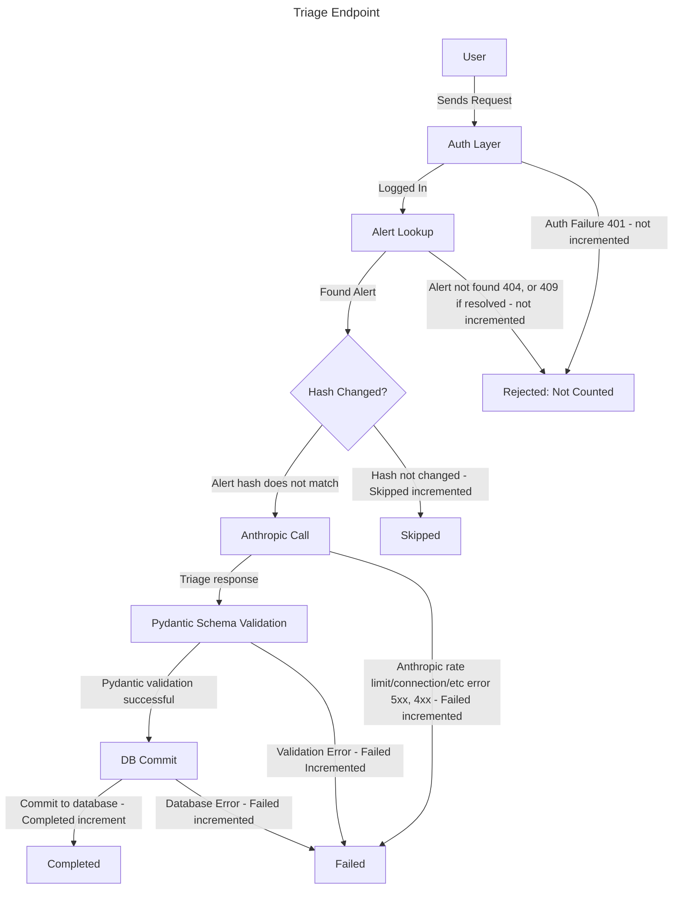

# Triage Fast Burn Runbook

## Summary

More than half of triage requests failed over the last 5 minutes, sustained for 2 minutes. Severity: page

## Description

Recording rule `slo:triage_errors:ratio_rate5m` measures the total triage requests that have failed over the past 5
minutes and divides them by the total triage requests excluding skipped.  
If `slo:triage_errors:ratio_rate5m` is greater than 0.5 for 2 minutes, this alert will fire.

Only Anthropic API errors, schema validation errors and database commit errors count as failed. Auth failures (401), missing alerts (404), and resolved alerts (409) never reach this metric.

## Impact

In the case of this alert firing, users can create, list, view, and update alerts. The triage function will return 502/503 errors. Users retrying triages can add load, and can trigger or prolong rate limiting.

## Diagram

## Rule

The [terraform apply rule](apidown.md#rule) from the APIDown runbook applies here as well.

## Fixes

## Disclaimer

The [Disclaimer](apidown.md#disclaimer) from the APIDown runbook applies here as well.

## Mitigation

## Verify
