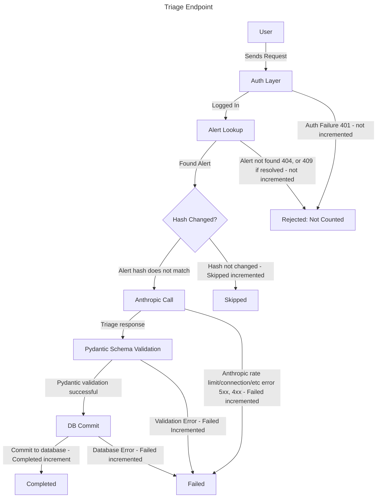

# Triage Fast Burn Runbook

## Summary

More than half of triage requests failed over the last 5 minutes, sustained for 2 minutes. Severity: page

## Description

Recording rule `slo:triage_errors:ratio_rate5m` measures the total triage requests that have failed over the past 5
minutes and divides them by the total triage requests excluding skipped.  
If `slo:triage_errors:ratio_rate5m` is greater than 0.5 for 2 minutes, this alert will fire.

Only Anthropic API errors, schema validation errors and database commit errors count as failed. Auth failures (401),
missing alerts (404), and resolved alerts (409) never reach this metric.

## Impact

In the case of this alert firing, users can create, list, view, and update alerts. The triage function will return
502/503 errors. Users retrying triages can add load, and can trigger or prolong rate limiting.

## Diagram



## Rule

The [terraform apply rule](apidown.md#rule) from the APIDown runbook applies here as well.

## Disclaimer

The [Disclaimer](apidown.md#disclaimer) from the APIDown runbook applies here as well.

## Checks

Run the saved query either using AWS Console or CLI.

CLI:

```bash
aws logs tail /ecs/watchfloor --since 30m --filter-pattern '{ $.level = "ERROR" }'
```

Console: CloudWatch --> Logs Insights --> Saved Queries --> `watchfloor/errors`, with a time range of the last 30
minutes.

The most frequent message names the cause of the alert. Reference the table below.

## Causes

| Message                           | Cause                                                                                                                             | Check                                                                                                       | Fix                                                                                                                 |
|-----------------------------------|-----------------------------------------------------------------------------------------------------------------------------------|-------------------------------------------------------------------------------------------------------------|---------------------------------------------------------------------------------------------------------------------|
| `Rate limit exceeded for alert`   | Anthropic is throttling our API requests. Common reasons: Retry storm, traffic spike, account limits or spend cap limits reached. | Anthropic console: usage and limits for the associated workspace                                            | Slow down or stop the retries or raise limits if legitimate requests                                                |
| `Connection error for alert`      | The API cannot reach Anthropic. Common reasons: NAT gateway, security group egress, DNS                                           | APIDown's [Networking](apidown.md#networking) checks, plus the NAT gateway.                                 | [Mitigation](#mitigation): restore terraform drift                                                                  |
| `Internal server error for alert` | Anthropic's servers failed (5xx) or are overloaded (529)                                                                          | The Anthropic status page                                                                                   | [Wait and re-check](#mitigation) escalate if it persists                                                            |
| `Api status error for alert`      | 401 (federation creds broken), 403 (workspace permissions), 400 (bad request, prompt size, model name), 404 (model doesn't exist) | Read the `Error code:` in the logged exception                                                              | 401/403 the federation settings in the task definition and the Anthropic console. 400/404: [roll back](#mitigation) |
| `Validation error for alert`      | Anthropic answered, but not in `TriageResult`'s shape. Most likely a truncation at the `max_tokens=600` or a recent schema change | The exception details (which field is it on), did a recent release touch `llm.py` or `TriageResult` schema? | [roll back](#mitigation)                                                                                            |
| `Database error for alert`        | The llm call succeeded, but the database commit failed (RDS restart or failover, storage full, stale connection, etc)             | RDS status in the console, or `aws rds describe-db-instances` in CLI.                                       | Wait, if RDS is recovering, otherwise escalate                                                                      |

### Extra information

A NAT outage may reach you as the dead man's switch page instead of this one, because Alertmanager can't reach SNS
either.  
With zero triage traffic, the ratio is 0/0 and doesn't exist, so this alert can't fire.

## Mitigation

[APIDown's Mitigations](apidown.md#mitigation)

[Anthropic Status Page](https://status.claude.com/) - check the status page, wait and re-check and if it persists with
the status page as green, escalate to Anthropic support.

**Rate-limit-actions**:
Run the `errors` query grouped by `alert_id` (or the `trace-request` query) to see whether one user or alert is
repeatedly calling triage.

Stop whatever is causing the retry storm, if there is one. For example, a script left open, or a user clicking the
triage button repeatedly.

Wait and see if throttling clears by itself once the excess traffic stops since Anthropic's rate limits are per-minute
windows.

If the traffic is legit, check the workspace's limits and spend cap in the Anthropic console, and raise them.

## Verify

Triage one alert successfully, see if the error ratio drops, and an alert resolution email arrives.
