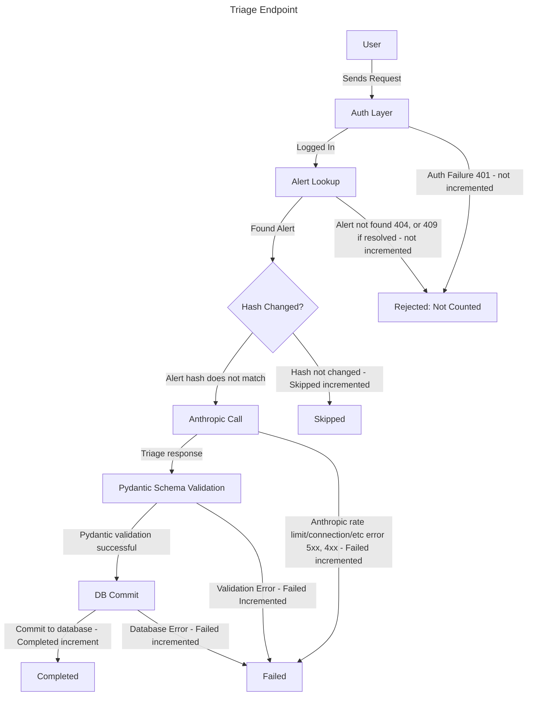

# Triage Slow Burn Runbook

## Summary

More than 10% of triage requests failed over the last 30 minutes, sustained for 10 minutes. Severity: ticket

## Description

Recording rule `slo:triage_errors:ratio_rate30m` measures the total triage requests that have failed over the past 30
minutes and divides them by the total triage requests excluding skipped.  
If `slo:triage_errors:ratio_rate30m` is greater than 0.1 for 10 minutes, this alert will fire.

Only Anthropic API errors, schema validation errors and database commit errors count as failed. Auth failures (401),
missing alerts (404), and resolved alerts (409) never reach this metric.

## Impact

In the case of this alert firing, some triage attempts fail (somewhere between 10% and 50%), while the rest will work
normally. While sustained, this alert will eat error budget over time, and can grow into a TriageFastBurn alert if not
handled.

## Diagram

## Rule

The [terraform apply rule](apidown.md#rule) from the APIDown runbook applies here as well.

## Disclaimer

The [Disclaimer](apidown.md#disclaimer) from the APIDown runbook applies here as well.

## Checks

Find the most frequently occuring message using [TriageFastBurn's Checks](triage-fast-burn.md#checks)

Then utilize the [TriageFastBurn's Causes](triage-fast-burn.md#causes) table.

Because failures are partial, look for a pattern, [Patterns](#patterns)

## Patterns

**How to run**: In Log Insights --> Saved Queries --> run `watchfloor/errors-over-time` and `watchfloor/errors-by-alert`
over the last 1 to 3 hours.

| What you can see                          | Query              | Suggests                                                                              | Next                                                                                                                                          |
|-------------------------------------------|--------------------|---------------------------------------------------------------------------------------|-----------------------------------------------------------------------------------------------------------------------------------------------|
| Failures grouped in certain 5 minute bins | `errors-over-time` | Rate limits during high traffic, or a problematic dependency                          | The rate-limit actions in [FastBurn's Mitigation](triage-fast-burn.md#mitigation), or the [Anthropic status page](https://status.claude.com/) |
| A steady trickle of errors                | `errors-over-time` | Input specific problems                                                               | Run `errors-by-alert`                                                                                                                         |
| The same `alert_id`s failing repeatedly   | `errors-by-alert`  | The alert's content, `max_tokens`, truncation, or a validation edge case of some sort | Inspect one with the `trace-request` query, or consider [rolling back](#mitigation) if a release started causing it.                          |

## Mitigation

[Mitigation](triage-fast-burn.md#mitigation)

## Verify

[Verify](triage-fast-burn.md#verify)
