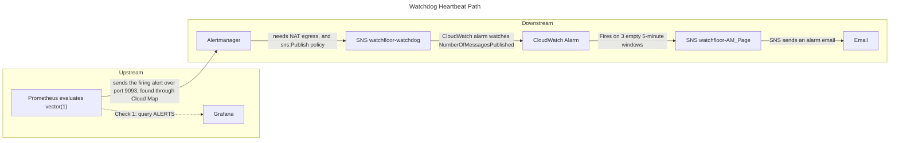

# Watchdog Runbook

## Summary

The heartbeat sent from the Watchdog alert rule has stopped arriving at CloudWatch. While this is broken, no other
alert can reach you. Severity: page

## Expected After Apply

After a fresh `terraform apply` workflow run, expect a `watchfloor-deadmans-switch` alarm. This is normal behavior since
when fresh
applying, CloudWatch creates a new alarm with no data at all. `FILL(m1, 0)` turns the empty windows into zeros, and
`treat_missing_data = "breaching"` counts them as failures. Once the heartbeat is transmitted, the alarm will resolve.
If the resolved email has not arrived within about 15 minutes of the apply finishing, treat the alarm as real and go to
Checks.

## Description

Watchdog is an alert rule defined by the expression: `vector(1)`, so this rule is always firing. This rule carries the
label `heartbeat="true"`, which routes it to its own receiver. Alertmanager is
connected to SNS to push a message to the topic `watchfloor-watchdog`, which CloudWatch watches. The CloudWatch Alarm
counts SNS `NumberOfMessagesPublished` per 5 minutes and will alarm after 3 empty windows in a row. The alarm can only
tell you that something in the system chain is broken, not where it is.

## Impact

When this alarm is active, users do not notice any issues, and the app may be running properly with no issues, or there
may even be an SLO problem, but we won't be able to see it since no other alerts can reach you. Alerts that cannot reach
you while this alarm is in effect include: APIDown, TriageFastBurn, TriageSlowBurn

## Diagram



## Rule

The [terraform apply rule](apidown.md#rule) from the APIDown runbook applies here as well.

## Disclaimer

The [Disclaimer](apidown.md#disclaimer) from the APIDown runbook applies here as well.

## Checks

### Check 1: Upstream or Downstream?

Navigate to `/scripts` in your CLI, then run `./grafana_tunnel.sh`. You will receive a link, open the link in your
browser and use the username: admin. Password is on your clipboard. Navigate to Grafana Explore and Run
`ALERTS{alertname="Watchdog"}` then utilize the table below.

| Explore                                    | Meaning                                                                                                     | Action                                                                                 |
|--------------------------------------------|-------------------------------------------------------------------------------------------------------------|----------------------------------------------------------------------------------------|
| Returns 1, `alertstate="firing"` returns 1 | Prometheus is evaluating properly, the problem is after it                                                  | [Downstream](#downstream-alertmanager-to-cloudwatch)                                   |
| The query runs but returns no data         | Prometheus is up but not evaluating the rule, example: the rules file isn't loading properly after a change | [Upstream](#upstream-prometheus)                                                       |
| Shows a data source error                  | Grafana is up, but can't reach Prometheus                                                                   | [Upstream](#upstream-prometheus)                                                       |
| The tunnel fails or Grafana won't load     | Unknown problem: Grafana itself could be broken                                                             | [Upstream Check 1 (ECS service state), then the Grafana service](#check-1-ecs-service) |

## Downstream (Alertmanager to CloudWatch)

### Check 1: Alertmanager Logs

Run:

```bash
aws logs tail /ecs/watchfloor/obs/alertmanager --since 1h --filter-pattern '?error ?ERROR'
```

Look for entries referencing: `err=`, `msg="Notify for alerts failed"`. Utilize the [Causes](#causes) table below.

### Causes

| `err` contains                                   | Actual cause                                                   | Where                                                                        |
|--------------------------------------------------|----------------------------------------------------------------|------------------------------------------------------------------------------|
| `AccessDenied`/`AuthorizationError`              | The Alertmanager task role lacks `sns:Publish` on the topic    | IAM, in Terraform                                                            |
| `timeout`/`context deadline exceeded`/`dial tcp` | Alertmanager can't reach the SNS endpoint at all               | [Network](apidown.md#networking): the NAT gateway or the private route table |
| `NotFound`                                       | The topic ARN in `alertmanager.yml` doesn't match a real topic | The config, the arn is hardcoded there                                       |
| No errors at all                                 | Alertmanager never received the alert                          | Prometheus --> Alertmanager (SG on 9093, or Cloud Map)                       |

## Upstream (Prometheus)

### Check 1: ECS Service

Run this to check counts for both services:

```bash
aws ecs describe-services --cluster watchfloor-cluster --services watchfloor-obs-prometheus-service watchfloor-obs-grafana-service --query "services[].{A_Name:serviceName, B_Running:runningCount, C_Desired:desiredCount}" --output table
```

After running the command, refer to this table below.

| Result                              | Meaning                                                                                                   | Next                                                  |
|-------------------------------------|-----------------------------------------------------------------------------------------------------------|-------------------------------------------------------|
| Prometheus `1 / 1`                  | The task is running but could be failing inside the actual app (TSDB writer lock, rules not loading, etc) | Check 2: logs                                         |
| Prometheus `0 / 1`                  | The task isn't staying up                                                                                 | The events command, then Check 2 for why it's exiting |
| Grafana `0 / 1`, Prometheus `1 / 1` | Grafana is the issue, and the heartbeat could be fine                                                     | The events command for Grafana, then Mitigation       |

Run this to check events for Prometheus:

```bash
aws ecs describe-services --cluster watchfloor-cluster --services watchfloor-obs-prometheus-service --query "services[].events[:5].[createdAt,message]" --output table
```

Run this to check events for Grafana:

```bash
aws ecs describe-services --cluster watchfloor-cluster --services watchfloor-obs-grafana-service --query "services[].events[:5].[createdAt,message]" --output table
```

### Check 2: Prometheus Logs

Run this to check logs for prometheus:

```bash
aws logs tail /ecs/watchfloor/obs/prometheus --since 1h --filter-pattern '?"lock DB directory" ?"loading rules" ?ERROR'
```

Refer to the table below to interpret results.

| Log shows                           | Meaning                                                                         | Action                                                                        |
|-------------------------------------|---------------------------------------------------------------------------------|-------------------------------------------------------------------------------|
| `lock DB directory`                 | Two tasks fighting for control over the TSDB, as in the rolling-deploy deadlock | [Mitigation](#mitigation) (stop the extra task, or force a new deployment)    |
| `loading rules`/ rule parsing error | An incorrect rules file deployed in the image                                   | [Mitigation](#mitigation): fix the rule, then Observability CD and plan/apply |
| Other `ERROR` lines                 | Read the `msg=` field                                                           | Escalate if you don't recognize the error                                     |

## Mitigation

| Fix                                 | When to use                                                                               | Action                                                                                                                         |
|-------------------------------------|-------------------------------------------------------------------------------------------|--------------------------------------------------------------------------------------------------------------------------------|
| Restore drift                       | The IAM role, the SG, or the NAT route have been altered by CLI or Console, not Terraform | [Link](apidown.md#mitigation)                                                                                                  |
| Fix Terraform code in a PR          | The task role in code lacks `sns:Publish`, the SG is missing 9093, and so on              | [Link](apidown.md#mitigation)                                                                                                  |
| Wait and re-check                   | A deploy is in progress or a fresh apply                                                  | [Link](apidown.md#mitigation)                                                                                                  |
| Escalate                            | Not covered in this runbook, or you have no further knowledge on the issue                | [Link](apidown.md#mitigation)                                                                                                  |
| Fix the observability configuration | An incorrect rules file, or a wrong topic ARN in `alertmanager.yml`                       | Fix in a PR and merge. Observability CD rebuilds only the image that's modified, then run apply workflow to roll out new image |
| Force a new deployment              | A TSDB lock issue, Grafana `0 / 1`, or a Prometheus task is stuck failing                 | Use the command below for whichever type is failing                                                                            |

**Prometheus**

```bash
aws ecs update-service --cluster watchfloor-cluster --service watchfloor-obs-prometheus-service --force-new-deployment
```

**Grafana**

```bash
aws ecs update-service --cluster watchfloor-cluster --service watchfloor-obs-grafana-service --force-new-deployment
```

**Alertmanager**

```bash
aws ecs update-service --cluster watchfloor-cluster --service watchfloor-obs-alertmanager-service --force-new-deployment
```

If `lock DB directory` errors continue after the new deployment, escalate.

## Verify

### Check 1

Rerun [Check's Check 1](#checks) query and confirm `ALERTS{alertname="Watchdog"}` returns 1 with
`alertstate="firing"`.

### Check 2

Run this command ~10 minutes after applying the fixes to see if there are any more errors.

```bash
aws logs tail /ecs/watchfloor/obs/alertmanager --since 10m --filter-pattern '?error ?ERROR'
```

### Check 3

Run this command:

```bash
aws cloudwatch describe-alarms --alarm-names watchfloor-deadmans-switch --query "MetricAlarms[].[StateValue,StateUpdatedTimestamp]" --output text
```

Look for `OK` as a response, roughly 10 minutes after applying the fix.

### Check 4

Check your inbox and look for a resolved email from `watchfloor-deadmans-switch`.

